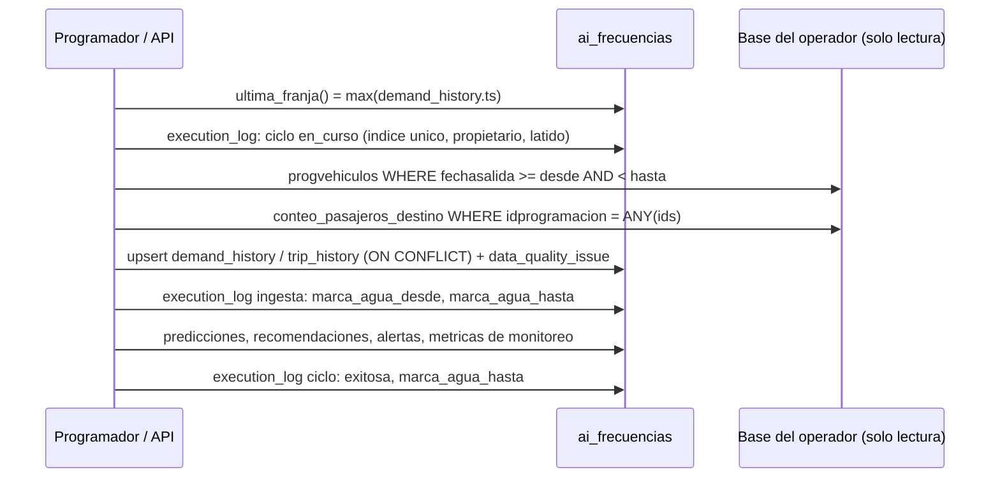
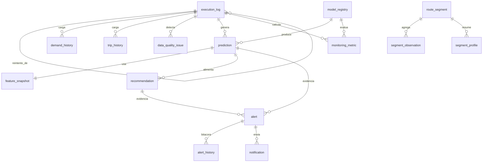

# E07 · Integración con PostgreSQL: mapa de tablas, marca de agua y rendimiento

Este documento describe cómo la solución lee la base del operador sin intervenirla y dónde guarda sus propios resultados. Cubre el entregable E07 de la especificación v1.5: consultas de solo lectura, marca de agua, mapa de tablas y análisis de rendimiento.

## 1. Dos bases, dos usuarios, dos permisos

| Base | Para qué | Usuario | Permisos | Cómo se garantiza |
|---|---|---|---|---|
| Base del operador (PostgreSQL 14, esquema `public`) | Fuente de verdad: programación, conteos de pasajeros, rutas, segmentos, estacionalidades, novedades | Usuario técnico entregado por Extreme Technologies | Solo `SELECT` | Toda conexión abre con `default_transaction_read_only=on` y `statement_timeout=300000` (5 min); ver `frecuencias/db.py::motor_fuente` |
| Base `ai_frecuencias` (PostgreSQL 14 + PostGIS, Docker) | Resultados de IA, histórico analítico, auditoría | `frecuencias_app`, miembro del rol `ai_frecuencias_app` | `SELECT`, `INSERT`, `UPDATE` sobre el esquema `ai_frecuencias`; `DELETE` solo en `segment_profile`; sin `TRUNCATE` ni DDL | Migraciones `0009_rol_aplicacion` y `0010_permiso_perfil_segmentos`, y `python -m frecuencias.persistencia.roles` |
| Base `ai_frecuencias` (migraciones) | Crear y versionar el esquema con Alembic | Dueño del esquema (`AI_DB_USER`) | DDL | Solo lo usa el servicio `migraciones` de Docker Compose |

El usuario de la aplicación no puede borrar historia: las alertas se cierran o descartan, los modelos se retiran y los paquetes viejos se archivan, nunca se eliminan. La única excepción es `segment_profile`, un resumen derivado que cada ciclo reemplaza con la ventana móvil de observaciones. Las pruebas `tests/test_roles.py` verifican cada permiso contra la base real: lectura, inserción y actualización permitidas; `DELETE` fuera de `segment_profile`, `TRUNCATE`, `CREATE TABLE`, `ALTER TABLE` y cambiar la versión del esquema, denegados.

Con esto se cumplen los controles de no interferencia de §11.3: usuario técnico de solo lectura, usuario separado que solo escribe en `ai_frecuencias`, transacciones `READ ONLY` con timeout, sin DDL sobre el esquema operacional y sin tocar triggers, funciones ni scripts.

## 2. Tablas del operador que se leen

Todas las consultas están en `frecuencias/ingesta/consultas.py` y se ejecutan con parámetros enlazados (`:desde`, `:hasta`, `:ids`), nunca con texto concatenado.

| Tabla (`public`) | Columnas usadas | Consulta | Uso en la solución |
|---|---|---|---|
| `progvehiculos` | `idprogramacion`, `idruta`, `idvehiculo`, `fechasalida`, `fecharegistro`, `fechainicio`, `fechafin`, `cancelada`, `finalizado`, `numeropasajeros`, `numerobajadas`, `distancia_recorrida`, `excedeplazosalida` | `QUERY_VIAJES_RANGO` | Viajes del rango nuevo: oferta actual (buses por hora), vehículos en ruta, despachos fallidos (ALT-006) y unión con los conteos |
| `conteo_pasajeros_destino` | `idprogramacion`, `fecha`, `cantidad_subida`, `cantidad_bajada`, `idvehiculo`, `latitud`, `longitud`, `acumulada_subida`, `acumulada_bajada` | `QUERY_CONTEO`, `QUERY_LECTURAS_SEGMENTO` | Demanda observada: subidas y bajadas por ruta y franja de 15 min; lecturas georreferenciadas para la carga por segmento |
| `rutas` | `idruta`, `nombre` | `QUERY_RUTAS` | Catálogo de rutas (2 = SILENCIO, 16 = CRA 54, 21 = CL 72) |
| `estacionalidades`, `estacionalidades_anio` | `estacionalidad`, `id_estacionalidad`, `fecha_inicio`, `fecha_fin` | `QUERY_ESTACIONALIDADES` | Variables de calendario (precarnaval, carnaval, Semana Santa) |
| `novedades_viales`, `novedades_viales_fecha` | `nombre`, `fecha`, `hora_inicio`, `hora_fin`, `porcentaje_impacto` | `QUERY_NOVEDADES` | Variable `impacto_evento` |
| `rutas_segmentos`, `rutas_segmentos_config` | `id`, `id_config`, `idruta`, `nro_segmento`, `longitud_m`, `geom_segmento`, `activo` | `QUERY_SEGMENTOS` | Catálogo geográfico de segmentos de 500 m |
| `timbradas_segmentos` | `id_viaje`, `id_segmento`, `subidas`, `bajadas` | `QUERY_TIMBRADAS_SEGMENTOS` | Solo para validar la réplica propia de la segmentación contra la del operador (99,7 % de coincidencia) |

### Por qué no se usan los consolidados como fuente del modelo

La especificación propone `timbradas_consolidado` y `timbradas_segmentos_consolidado` como fuente principal. En el acceso entregado para el reto, `timbradas_segmentos` solo cubre ocho semanas (1 de enero a 27 de febrero de 2023), y sus horas están desplazadas dos horas respecto de los sensores y los despachos: la correlación franja a franja sube de 0,47 a 0,71 al correr los sensores dos horas. Por eso la demanda se construye en la capa analítica propia a partir de `conteo_pasajeros_destino` (176 millones de lecturas 2023–2025). La suma de lecturas por viaje tiene correlación 0,9999 con `progvehiculos.numeropasajeros`, lo que respalda la fuente.

Los scripts de segmentación del operador no se pueden ejecutar en un acceso de solo lectura, porque escriben en `timbradas_segmentos`. Su lógica se reprodujo en `frecuencias/segmentos/carga.py`, que escribe en `ai_frecuencias.segment_observation`. Coincide en 99,7 % con la salida del operador en los viajes que ambos cubren.

Esta decisión debe validarse con Extreme Technologies (ver [validaciones pendientes](validaciones_pendientes.md)). Si los consolidados se completan, basta con cambiar las consultas de `consultas.py`: el resto del flujo no depende de la tabla de origen.

### Campos de la especificación que no se usan

- **Sentido.** Ni el conjunto mínimo (§6.1) ni el esquema lógico (§8.2) definen una columna de sentido. Las tres rutas son circuitos cerrados: el inicio del primer segmento y el fin del último quedan a menos de 60 m, con recorridos de 61 a 67 km. Por eso `nro_segmento` ya ordena el itinerario completo. Las columnas `sentido` de `prediction`, `recommendation` y `alert` quedan reservadas y vacías hasta que el operador defina cómo separar ida y vuelta.
- **Zona tarifaria.** Solo existe en las tablas `timbradas_*_zonas`, que dependen de los consolidados descartados arriba.
- **`frecuenciadespachos`, `cap_min_autorizada` y `cap_max_autorizada`.** La frecuencia vigente se mide con los despachos reales de `progvehiculos` (`optimizacion/oferta.py`) y la capacidad es un parámetro versionado por ruta. Ambas deben contrastarse con los valores configurados por el operador.

## 3. Marca de agua y lectura incremental

- **Inicio de la ventana.** `desde = max(demand_history.ts) + 15 min`, con `hasta = min(desde + días, hora actual)`. Solo se leen viajes con `fechasalida` en ese rango y sus lecturas por `idprogramacion`, lo que aprovecha los índices `idx_progvehiculos_fecha1` e `idx_conteo_pasajeros_destino_idprog`.
- **Idempotencia.** La carga es un upsert por clave natural (ruta y franja; `idprogramacion`). Repetir el mismo lote de 808.345 registros no duplica nada (`reportes/volumen_ingesta.json`, `carga_repetida_no_duplica: true`).
- **Ventana pendiente (RNF-001).** Si un ciclo cae después de la ingesta y antes de predecir, la marca de agua del ciclo (`execution_log.marca_agua_hasta` del último ciclo exitoso) queda atrás. El siguiente ciclo, o el reintento, procesa desde esa marca, con un tope de 7 días, aunque no lleguen datos nuevos. Así no se pierden lotes, predicciones ni alertas tras un reinicio. Se verificó con un ciclo real que falló en la etapa de monitoreo y se reintentó. También se mató la API con `docker kill` a mitad de un ciclo: al volver lo marcó `interrumpida` y lo reanudó sola como intento 2, que terminó bien (`docs/evidencias/caida_api.json`).
- **Trazabilidad.** Cada lote queda en `execution_log` con ventana, registros leídos y rechazados, correlation id, propietario, intento y error. Los problemas de calidad quedan en `data_quality_issue` con regla, fila y causa.

La especificación menciona `ultima_actualizacion` como marca de los consolidados. Como la fuente efectiva son los conteos crudos, que no tienen esa columna, la marca usada es la franja temporal de las lecturas. Si el operador corrige lecturas pasadas, el ciclo no las vuelve a leer. Para eso existe la recarga por rango (`python -m frecuencias.ingesta.historico --desde AAAA-MM-DD --hasta AAAA-MM-DD --origen base`), que es idempotente porque hace upsert y no mueve la marca de agua del ciclo. Falta que el operador indique cómo detectar qué periodos cambiaron, porque los conteos crudos no tienen una marca de modificación.

## 4. Tablas propias (`ai_frecuencias`)

Creadas y versionadas con Alembic (`migrations/versions/0001` a `0011`). Todas usan `TIMESTAMPTZ` en UTC; la API presenta las horas en `America/Bogota`.

| Tabla | Filas hoy | Contenido | Claves y restricciones relevantes |
|---|---:|---|---|
| `execution_log` | 73 | Cada lote o ciclo: tipo, estado, ventana, propietario, latido, etapa, avance, intento, `reintento_de`, detalle JSON | Índice único parcial: un solo `ciclo` en curso; `estado IN (en_curso, exitosa, fallida, interrumpida)` |
| `demand_history` | 239.748 | Histórico analítico por ruta y franja de 15 min (subidas, bajadas, viajes, lecturas, validez) | PK (`id_ruta`, `ts`) |
| `trip_history` | 557.162 | Copia analítica de la programación de viajes | PK `idprogramacion` |
| `data_quality_issue` | 39.470 | Problemas de calidad por lote, regla (CAL-xxx), dimensión, fila y causa | FK a `execution_log` |
| `model_registry` | 10 | Versiones de modelo: horizonte, hiperparámetros, métricas, datos usados, artefacto y SHA-256, estado, aprobación | `estado IN (candidato, activo, retirado, rechazado)` |
| `prediction` | 5.040 | Predicción puntual, límites p10–p90, versión de variables, fecha de corte, latencia y explicación | Única por modelo, ruta, sentido, segmento, franja objetivo y horizonte; FK a `model_registry` |
| `feature_snapshot` | 5.040 | Variables exactas usadas en cada predicción | FK a `prediction` |
| `recommendation` | 748 | Buses/h, headway, vehículos, viabilidad y motivo, desglose de la función objetivo y línea base | FK a `prediction` |
| `alert`, `alert_history` | 777 / 779 | Alertas ALT-001 a ALT-010 con evidencia, umbral, estado y bitácora | Deduplicación por clave mientras la alerta está abierta |
| `notification` | 0 | Envíos por correo y WhatsApp (simulados sin credenciales) | FK a `alert` |
| `operational_parameter` | 115 | Umbrales y pesos versionados, generales o por ruta | Una versión vigente por clave y ruta |
| `monitoring_metric` | 24 | Deriva PSI, error móvil, cobertura de intervalos, volumen y alertas descartadas | FK a `execution_log` y `model_registry` |
| `route_segment`, `segment_observation`, `segment_profile` | 386 / 1.175.825 / 18.766 | Segmentos (PostGIS, índice GiST), carga por viaje y segmento, perfil por tipo de día y hora | `geom geometry(LineString, 4326)` |
| `api_key` | 70 | Claves de acceso por rol, guardadas como huella SHA-256 | Huella única; nombre único entre las activas |

## 5. Análisis de rendimiento

### Consultas a la base del operador (`EXPLAIN (ANALYZE, BUFFERS)`, día 2025-11-11)

Generado con `python pruebas/explain_fuente.py`; el detalle está en `docs/evidencias/explain_fuente.json`.

| Consulta | Plan | Tiempo | Filas |
|---|---|---:|---:|
| Viajes del día (`progvehiculos`) | Index Scan con `idx_progvehiculos_fecha1` | 5,7 ms | 1.461 |
| Conteo agregado por franja (`conteo_pasajeros_destino` ⨝ `progvehiculos`) | Merge Join de dos Index Scan (`idx_conteo_pasajeros_destino_idprog`, `progvehiculos_pkey`) + Sort + Aggregate | 5,6 s | 447.053 lecturas → 703 franjas |

Ninguna consulta hace lecturas secuenciales sobre tablas grandes. El costo de la segunda está en ordenar 447.000 lecturas de un día. Se ejecuta una vez por ciclo, en modo solo lectura y con timeout de 5 minutos. No se solicitaron índices nuevos. Si el volumen crece, la recomendación para el DBA es un índice compuesto (`idprogramacion`, `fecha`) en `conteo_pasajeros_destino`, previa revisión con `EXPLAIN`, como exige §8.3.

### Volumen de ingesta (RNF-003)

`python pruebas/volumen_ingesta.py` (`docs/evidencias/volumen_ingesta.json`):

- **Primera carga:** 808.345 registros en 148,6 s (5.438 registros/s), con un pico de memoria de 964 MB y 0 rechazados.
- **Carga repetida del mismo lote:** 152,3 s, sin duplicados.

### Consultas de la API (RNF-002)

`python pruebas/carga_api.py`: 10 usuarios concurrentes durante 62 s, 1.076 peticiones y 0 errores (`docs/evidencias/carga_api.json`).

| Consulta | p50 | p95 | p99 |
|---|---:|---:|---:|
| Predicciones paginadas | 94 ms | 146 ms | 160 ms |
| Recomendaciones paginadas | 94 ms | 138 ms | 185 ms |
| Alertas filtradas | 89 ms | 129 ms | 149 ms |
| Resumen de alertas | 75 ms | 113 ms | 123 ms |
| Perfil por segmento | 81 ms | 119 ms | 138 ms |
| Ejecuciones | 89 ms | 129 ms | 166 ms |
| Predicción bajo demanda (calcula variables e inferencia) | 4,4 s | 4,7 s | 5,0 s |

Todas las consultas paginadas tienen p95 bajo 150 ms, frente al límite de 2 s del RNF-002. La predicción bajo demanda no es una consulta paginada: construye las variables y ejecuta el modelo. Por eso el ciclo programado precalcula las predicciones y el tablero las lee ya guardadas.
