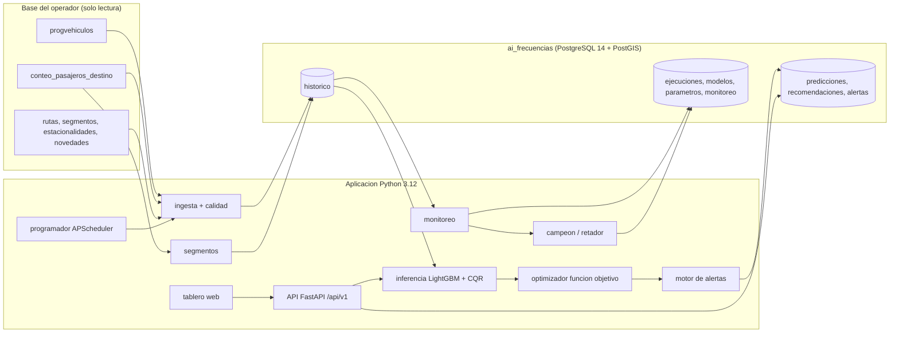

# Manual técnico

Este manual es para quien mantiene o extiende la solución. Explica cómo está organizada, cómo fluye un ciclo y dónde vive cada decisión. Para instalarla, ver el [manual de despliegue](manual_despliegue.md). Para usar el tablero, ver el [manual de usuario](manual_usuario.md). Las razones de cada línea de código están en `comentarios_codigo.pdf`, porque el código no lleva comentarios por convención del equipo.

## 1. Arquitectura



| Paquete | Responsabilidad |
|---|---|
| `frecuencias/ingesta` | Consultas de solo lectura a la base del operador, carga incremental idempotente, circuit breaker y reintentos (`historico.py`, `consultas.py`, `extraccion.py`) |
| `frecuencias/analitica` | Calidad de datos (reglas CAL-xxx), serie de 15 min, variables del modelo, monitoreo (PSI, cobertura, volumen, alertas descartadas) |
| `frecuencias/inferencia` | Entrenamiento, cuantiles con calibración conforme (CQR), artefactos con huella SHA-256, predicción explicable, retención de paquetes |
| `frecuencias/optimizacion` | Parámetros por hora y tipo de día, oferta actual, función objetivo (§10.2) y fórmulas de línea base (§10.3) |
| `frecuencias/alertas` | Reglas ALT-001 a ALT-010, notificaciones por correo y WhatsApp |
| `frecuencias/operacion` | Ciclo incremental, trabajos (latido, recuperación, reintentos), programador, reentrenamiento campeón/retador |
| `frecuencias/segmentos` | Réplica de la segmentación del operador con PostGIS, perfil de carga por segmento y tramo crítico |
| `frecuencias/persistencia` | Tablas SQLAlchemy Core y repositorios del esquema `ai_frecuencias`; rol de base de datos |
| `frecuencias/api` | FastAPI, esquemas Pydantic, errores uniformes, autenticación por clave y rol |
| `frecuencias/tablero` | Tablero web estático (HTML, CSS, JS sin dependencias) servido por la API: predicción y recomendación, alertas, ejecuciones, modelos, parámetros y exportación |
| `frecuencias/observabilidad.py`, `trazas.py`, `resiliencia.py`, `seguridad.py` | Logs JSON, métricas Prometheus, trazas OpenTelemetry, circuit breaker, claves de acceso |
| `migrations/` | Alembic: 11 migraciones del esquema `ai_frecuencias` |
| `pruebas/` | Pruebas de carga, volumen, EXPLAIN, humo en Docker, E2E del tablero, informe de SonarQube, paquete y demostración del ciclo, sesgo por segmento e informe de modelos activos |
| `tests/` | 410 pruebas pytest (unitarias, integración con la base, API, ML, contrato) |

## 2. El ciclo incremental

`frecuencias/operacion/ciclo.py::ejecutar_ciclo` corre como trabajo: desde el programador cada hora (`CICLO_CRON`), desde `POST /api/v1/frequency/executions` o desde la terminal. Cada etapa actualiza `execution_log.etapa` y `avance`, que la API y el tablero muestran.

| Avance | Etapa | Qué hace |
|---:|---|---|
| 5 % | `ingesta` | Lee viajes y conteos nuevos desde la marca de agua; valida calidad; upsert en el histórico |
| 25 % | `segmentos` | Asigna lecturas a segmentos y actualiza el perfil de carga (solo con origen `base`) |
| 35–75 % | `prediccion_y_recomendacion` | Por día, ruta y hora de servicio: predicción a 30/60/120 min, recomendación optimizada, alertas de oferta y de observación |
| 75 % | `alertas` | Calidad (ALT-008/009), despachos fallidos (ALT-006), datos atrasados (ALT-009) |
| 82 % | `monitoreo` | Error móvil, cobertura, deriva, volumen y alertas descartadas; ALT-010; métricas en `monitoring_metric` |
| 88 % | `reentrenamiento` | Campeón/retador si hay degradación, deriva o periodicidad, con al menos 24 h entre intentos |
| 100 % | `terminada` | Marca de agua del ciclo y detalle completo en `execution_log.detalle` |

### Trabajos, recuperación y reintento (RNF-001, RNF-004)

- **Un solo ciclo a la vez, entre procesos.** Un índice único parcial en `execution_log` (`tipo = 'ciclo' AND estado = 'en_curso'`) impide dos ciclos simultáneos aunque los lancen la API y el programador desde máquinas distintas. El segundo recibe `409`.
- **Latido.** Cada proceso tiene una instancia `servicio@host#id` y un hilo que cada `EJECUCION_LATIDO_S` (30 s) actualiza `latido_en` de sus ejecuciones en curso.
- **Recuperación.** Al arrancar, y cada minuto en el programador, las ejecuciones sin latido por más de `EJECUCION_SIN_LATIDO_S` (180 s) pasan a `interrumpida`. También pasan las de una instancia anterior del mismo servicio en el mismo host, que ya está muerta. La marca es atómica (`UPDATE … RETURNING`): si dos procesos arrancan a la vez, solo uno la toma.
- **Reanudación.** Un ciclo interrumpido se reintenta solo, si `CICLO_REANUDAR=activa` y no se agotaron `CICLO_INTENTOS` (3). El reintento hereda origen, días, modo de reentrenamiento y correlation id, y queda enlazado con `reintento_de`.
- **Reintento por fallo transitorio.** Si la fuente no responde (`OperationalError`, `InterfaceError`, circuito abierto), el programador reintenta a los 5, 15 y 45 minutos. Los errores de código o de datos no se reintentan solos; se pueden reintentar con `POST /frequency/executions/{id}/retry` o con el botón del tablero.
- **Sin pérdida de lotes.** La ventana de cada ciclo empieza en la marca de agua del último ciclo exitoso, no solo en la última ingesta. Si un ciclo cayó después de ingerir, el siguiente predice y alerta sobre esos datos.

## 3. Modelo de demanda

- **Tarea.** Subidas por ruta y franja de 15 min a 30, 60 y 120 minutos, un modelo por horizonte.
- **Algoritmo.** LightGBM con objetivo de Poisson, hiperparámetros por búsqueda bayesiana (Optuna, 15 intentos, validación temporal de 4 pliegues) y 22 variables que solo usan información anterior al instante de predecir. Una prueba de alteración del futuro lo verifica.
- **Incertidumbre.** Cuantiles p10, p50 y p90 con calibración conforme (CQR); el intervalo del 80 % cubre 81,6–82,5 % en prueba.
- **Resultados en prueba (mayo a noviembre de 2025).**

  | Horizonte | WAPE LightGBM | WAPE base 4 semanas | WAPE base semana pasada | MAE modelo / base |
  |---|---:|---:|---:|---:|
  | 30 min | 10,1 % | 14,9 % | 18,4 % | 16,9 / 24,9 |
  | 60 min | 10,5 % | 14,9 % | 18,4 % | 17,6 / 24,9 |
  | 120 min | 10,8 % | 14,9 % | 18,4 % | 18,2 / 24,9 |

- **Artefactos.** Cada paquete (`modelos/paquetes/<modelo>-<version>`) tiene modelo puntual, cuantiles, `meta.json` y `manifiesto.json` con SHA-256 de cada archivo. La API verifica la huella antes de cargar y rechaza paquetes alterados. `modelos/` está marcado como binario en `.gitattributes` para que git no cambie fines de línea.
- **Demanda por segmento.** El modelo predice por ruta; `GET /predictions/{id}/segments` reparte esa predicción con la cuota histórica de subidas de cada segmento. En diciembre de 2025, con cuotas calculadas solo con noviembre, el WAPE por segmento y hora es de 44 %: sirve para ubicar el tramo cargado, no como pronóstico exacto de cada parada. El sesgo bruto de +8,5 % viene casi todo de la cobertura: las observaciones por segmento recogen el 92,8 % de las subidas de la ruta, y al descontarla queda en +0,7 % (`docs/evidencias/sesgo_segmentos.json`).
- **Campeón/retador.** El candidato se entrena con los datos anteriores a una ventana de comparación que ninguno de los dos vio. Solo se activa si mejora el WAPE o la desviación de Poisson sin empeorar la otra y supera a la línea base. La decisión queda en `model_registry` y en el detalle del ciclo; el modelo anterior queda disponible para revertir (`POST /models/{id}/activate`).

## 4. Optimización de frecuencia (§10.2)

`frecuencias/optimizacion/objetivo.py::optimizar` elige, para cada ruta y hora, los buses por hora `b` que minimizan:

```
costo(b) = α · b · ciclo / 60                         (vehículo-horas de operación)
         + β · demanda · 0,5 / b                      (pasajero-horas de espera: headway / 2)
         + γ · E[max(0, carga − b · capacidad · ocupación_objetivo)]   (pasajeros sobre la capacidad objetivo)
         + δ · |b − b_actual|                         (cambio frente a lo que se opera hoy)
```

- La carga sigue una normal con media `demanda · factor_carga` y desviación `(p90 − p50) / 1,2816 · factor_carga`, tomada del intervalo del modelo. El exceso esperado tiene forma cerrada, de modo que la incertidumbre de la demanda entra en la decisión.
- **Restricciones duras:**
  - nivel de servicio: `b ≥ ceil(60 / headway_máximo)`;
  - capacidad crítica con la demanda media: `b · capacidad · ocupación_crítica ≥ carga media`;
  - headway mínimo: `b ≤ floor(60 / headway_mínimo)`;
  - flota disponible: vehículos requeridos ≤ flota, con la duración del ciclo.
- **Método.** Búsqueda exhaustiva sobre los enteros factibles, a lo sumo 30 valores, lo que garantiza el óptimo global y es auditable.
- **Inviabilidad.** Si las restricciones no se pueden cumplir, la recomendación se marca `viable = false` y explica por qué, en lugar de forzar una cifra.
- **Pesos.** Están en `operational_parameter` (`peso_costo_operativo` 1,0; `peso_tiempo_espera` 0,1; `peso_sobreocupacion` 1,0; `peso_desviacion_frecuencia` 0,5), versionados y modificables sin desplegar. Con estos valores de referencia el optimizador reproduce la línea base de §10.3 cuando la demanda la justifica. Son una propuesta del equipo que SOBUSA debe validar.
- **Fin del servicio.**
  - **Ventana de despachos.** `oferta.ventana_servicio` calcula la de cada ruta y día:
    - apertura: la menor entre la primera salida programada del día y la mediana de las 4 semanas previas del mismo día de la semana;
    - cierre: la mayor entre la última salida programada del día y esa misma mediana.

    En un día en curso, la programación cargada llega solo hasta la hora actual, y lo habitual evita declarar cerrada una ruta que sigue operando.
  - **Horas fuera de la ventana.** Un bloque con menos de 25 % de su hora dentro de la ventana no se recomienda.
  - **Hora parcial.** En un bloque parcial, los buses operados se convierten en tasa por hora dentro del servicio: 3 salidas en 46 minutos equivalen a 3,9 buses por hora.
  - **Registro.** La recomendación guarda `fraccion_servicio` y `ventana_servicio`. `GET /overview` marca como `fuera_de_servicio` las recomendaciones antiguas que caen fuera de la ventana.
- **Recaudo.** `recommendation.parametros.recaudo` guarda los pasajeros esperados y los que quedarían sobre la capacidad en el tramo más cargado, con la frecuencia recomendada y con la actual. Con `tarifa_pasajero` definida los expresa en pesos; sin ella, esos campos quedan en `null`. No entra en la función objetivo: la referencia de §10.2 no lo incluye.
- **Salida.** `recommendation.parametros.objetivo` guarda los componentes del costo, las tres mejores alternativas, la restricción que limita (`funcion_objetivo`, `servicio_minimo`, `capacidad_critica`, `headway_minimo`, `flota`), y la sensibilidad a cada peso multiplicado por 0,5 y por 2. `linea_base` guarda el resultado de las fórmulas de §10.3 para comparar.

## 5. Alertas

| Código | Regla | Parámetros (`operational_parameter`) |
|---|---|---|
| ALT-001 | Carga p90 con la oferta actual ≥ umbral de capacidad | `umbral_alta_demanda` |
| ALT-002 | Ocupación esperada con la oferta actual ≥ crítica | `ocupacion_critica` |
| ALT-003 | Oferta actual bajo la recomendada, más allá de la tolerancia absoluta y relativa | `tolerancia_frecuencia_buses`, `tolerancia_frecuencia_pct` |
| ALT-004 | Ocupación esperada bajo el mínimo con más buses de los recomendados | `baja_utilizacion` |
| ALT-005 / ALT-007 | Demanda real por debajo o por encima del intervalo, con desvío ≥ error tolerado | `error_pronostico` |
| ALT-006 | En una hora, al menos 2 despachos programados y al menos 25 % del total salieron cancelados, sin iniciar o fuera de plazo (`excedeplazosalida`) | `despachos_fallidos_min`, `despachos_fallidos_pct` |
| ALT-008 | Consolidado con valores atípicos | Reglas CAL-003/007/008 |
| ALT-009 | Día sin lecturas, datos atrasados o fuente no disponible | `datos_atrasados` |
| ALT-010 | Error móvil (WAPE) sobre la tolerancia, o cobertura del intervalo bajo el mínimo, con al menos 3 días observados | `error_pronostico`, `cobertura_intervalo_min` |

Las alertas se deduplican por clave mientras están abiertas y conservan bitácora de estados. Las nuevas críticas se notifican por los canales configurados; sin credenciales, el envío queda como `simulada`.

Para no saturar al operador:

- `GET /api/v1/alerts/groups` agrupa por ruta, código, severidad y día local de la ventana, con los identificadores, las horas y un ejemplo.
- `POST /api/v1/alerts/status` cambia hasta 500 alertas a la vez. Cada una pasa por las mismas reglas de transición y bitácora que el cambio individual; las que no se pueden cambiar se informan sin abortar el lote.

El resumen del día (`GET /api/v1/overview`) toma la recomendación más reciente de cada ruta y hora (`recomendaciones.vigentes_por_hora`) y la traduce a una acción (`resumen.accion`: agregar, retirar, mantener, programar o no viable). También muestra el observado de la hora y las alertas pendientes. No recalcula nada, así que responde al instante.

## 6. Monitoreo (§9.4)

En cada ciclo se calculan, se guardan en `monitoring_metric`, se exponen en `GET /api/v1/monitoring` y en la métrica Prometheus `frecuencias_monitoreo{metrica, alcance}`:

| Métrica | Cómo se calcula | Umbral | Acción |
|---|---|---|---|
| `deriva_psi` por ruta | PSI de las subidas de los últimos 7 días frente a las 8 semanas previas al corte del modelo activo (10 tramos por cuantiles) | `deriva_psi_max` = 0,25 | Dispara reentrenamiento |
| `error_movil_wape` por horizonte | WAPE de las predicciones del modelo activo contra lo observado en 7 días | `error_pronostico` (15 %) | ALT-010 y reentrenamiento |
| `cobertura_intervalo` por horizonte | Fracción de franjas observadas dentro de p10–p90 (nominal 80 %) | `cobertura_intervalo_min` = 65 % | ALT-010 y reentrenamiento |
| `volumen_predicciones` | Predicciones del último día frente a la mediana de los 7 previos | `volumen_predicciones_min` = 50 % | Aviso |
| `alertas_descartadas` global y por código | Descartadas sobre gestionadas en 30 días, con al menos 5 gestionadas | `alertas_descartadas_max` = 30 % | Revisar la calibración de la regla |

Valores del último ciclo real con datos hasta diciembre de 2025:

- **Cobertura:** 76–81 %.
- **WAPE móvil:** 11–13 %.
- **PSI:** 0,08–0,21, sin deriva.

## 7. Observabilidad

- **Logs JSON** (structlog) en la salida estándar. Cada línea lleva `correlation_id`; con trazas activas lleva también `trace_id` y `span_id`. Los errores pasan por `describir_error`, que quita SQL, hosts, IP y usuarios.
- **Métricas Prometheus** en `/metrics`:
  - peticiones y duración;
  - predicciones, recomendaciones, alertas y notificaciones;
  - ejecuciones por estado;
  - avance del ciclo;
  - latencia de los datos;
  - circuito abierto;
  - métricas de monitoreo.
- **Trazas OpenTelemetry** (RNF-006). Se activan con `OTEL_TRACES_EXPORTER=otlp` (o `console`). Cubren:
  - peticiones HTTP, instrumentadas en FastAPI;
  - consultas SQL de los dos motores;
  - cada etapa del ciclo, como tramos `ciclo.*`.

  El exportador OTLP/HTTP envía a `OTEL_EXPORTER_OTLP_ENDPOINT`. Docker Compose trae Jaeger en el perfil `observabilidad`. La instrumentación de SQLAlchemy declara soporte hasta 2.0.x; se activa con `skip_dep_check` porque el proyecto usa 2.1, y `tests/test_trazas.py` verifica que funcione.
- **Correlation id.** Viaja en la cabecera `X-Correlation-Id`, se guarda en `execution_log` y se hereda en los reintentos.

## 8. Seguridad

- **Claves de acceso por rol** (`lector` < `operador` < `administrador`) en la cabecera `X-API-Key`. Se guardan como huella SHA-256 y se crean o revocan con `python -m frecuencias.seguridad crear|revocar|listar`.
- **Usuarios de base de datos separados** (ver [E07](E07_mapa_tablas.md)): solo lectura en la fuente; en `ai_frecuencias`, sin borrado ni DDL. La clave del usuario de aplicación se envía como verificador SCRAM-SHA-256, nunca en texto plano.
- **Sin secretos en el repositorio.** Todo va por variables de entorno (`.env` está en `.gitignore`; la plantilla es `.env.example`).
- **Swagger UI** solo fuera de producción, o con `API_DOCS=activa`.
- **Recursos externos del tablero.** Ninguno: todo se sirve desde la propia API.

  Si no hay conexión, el resto del tablero funciona igual.
- **Integraciones externas** (fuente, SMTP, WhatsApp) con timeout, reintento controlado y circuit breaker (RNF-010).

## 9. Pruebas y calidad

| Nivel | Dónde | Cómo correr |
|---|---|---|
| Unitarias, integración, API, ML y contrato | `tests/` (410 pruebas, 80 % de cobertura) | `python -m pytest` (con la base cargada); `-m "not lenta"` omite las que cargan datos y modelos reales |
| Contrato de la API | `tests/test_contrato.py` | Corre en CI: compara la API con `docs/openapi.json`, los endpoints mínimos de §12.2 y el error uniforme de toda ruta protegida |
| Carga (RNF-002) | `pruebas/carga_api.py` | Con la API levantada |
| Volumen (RNF-003) | `pruebas/volumen_ingesta.py` | Base temporal en Docker |
| Rendimiento SQL | `pruebas/explain_fuente.py` | Contra la base del operador, solo lectura |
| Humo en Docker | `pruebas/humo_docker.py` | Con `docker compose up` |
| Ciclo completo (§14.2) | `pruebas/demo_ciclo.py` | Con la API operando; datos nuevos desde `datos/` o desde la base del operador |
| Redistribución de la flota (E01) | `pruebas/redistribucion.py` | Contra `ai_frecuencias`, solo lectura, con los modelos vigentes antes del periodo |
| Sesgo por segmento (§9.3) | `pruebas/sesgo_segmentos.py` | Contra `ai_frecuencias`, con cuotas calculadas solo con datos previos a la ventana |
| E2E del tablero, accesibilidad y modo móvil | `pruebas/e2e_tablero.py` | Playwright con Edge del sistema |
| Análisis estático | SonarQube | Ver [despliegue §6](manual_despliegue.md#6-integracion-continua-y-sonarqube) |

La integración continua (`.github/workflows/ci.yml`) tiene tres trabajos:

- **Pruebas:** levanta PostGIS, aplica, revierte y reaplica las migraciones, crea el usuario de aplicación y corre las pruebas.
- **Calidad:** levanta su propio servidor SonarQube, analiza con la cobertura de las pruebas y falla si hay hallazgos críticos o bloqueantes.
- **Imagen:** construye la imagen Docker.

Último análisis: 0 bugs, 0 vulnerabilidades, 0 code smells, 0 puntos de seguridad y 0,3 % de duplicación (`docs/evidencias/sonarqube.json`).

## 10. Cómo extender

- **Nueva regla de alerta.** Función pura en `alertas/reglas.py` que devuelva diccionarios con `_alerta(...)`. Llamarla desde `operacion/ciclo.py` o `operacion/recomendacion.py`, con sus umbrales sembrados por migración en `operational_parameter`.
- **Nueva métrica de monitoreo.** Función en `analitica/monitoreo.py` que devuelva filas con `metrica`, `alcance`, `valor`, `umbral` y `estado`. Agregar el nombre al `CHECK` de `monitoring_metric` con una migración.
- **Nueva fuente.** Consulta parametrizada en `ingesta/consultas.py`. El resto del flujo consume el histórico de `ai_frecuencias`, no la fuente.
- **Documentación.** Cada cambio de código se documenta en `comentarios_codigo.pdf`, no en comentarios dentro del código.
