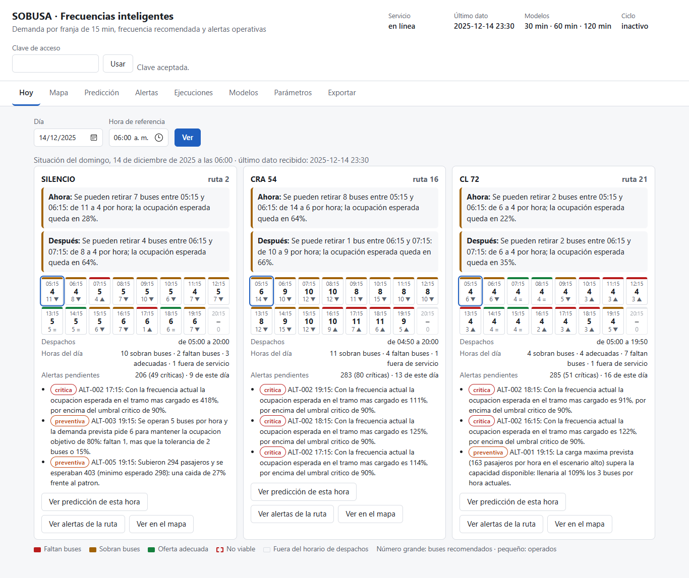
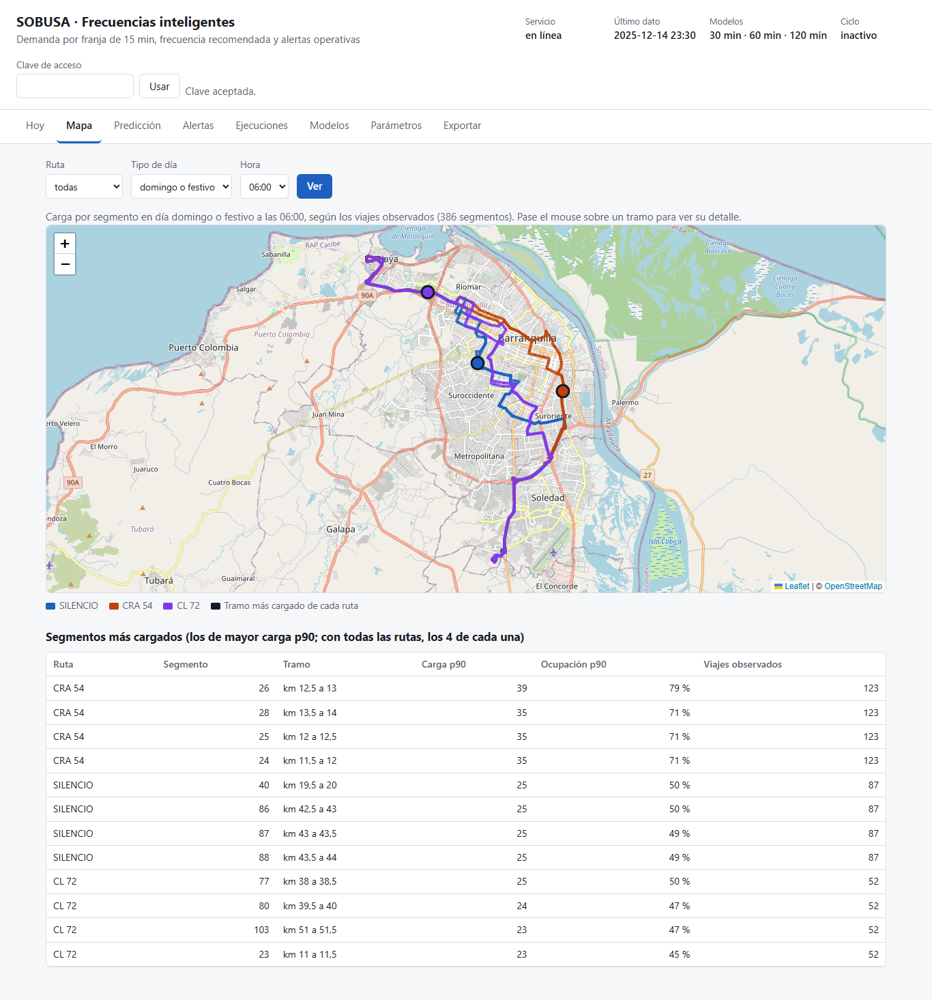
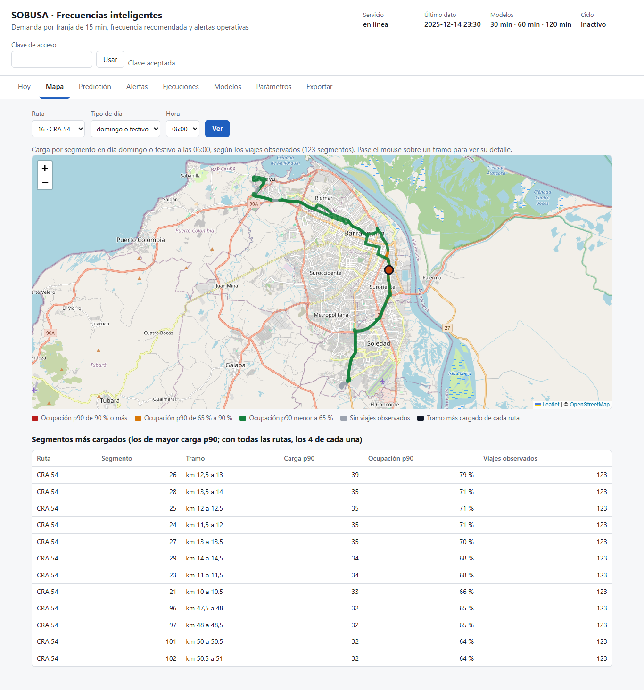
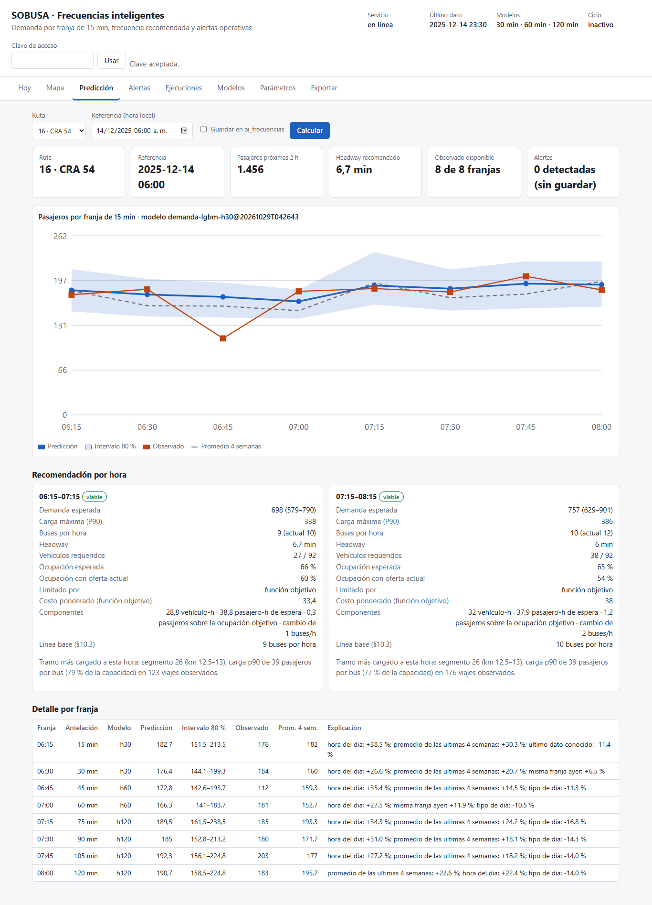
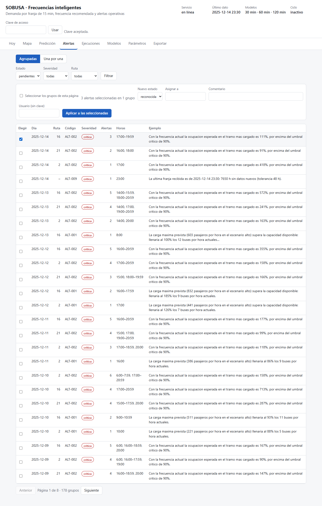
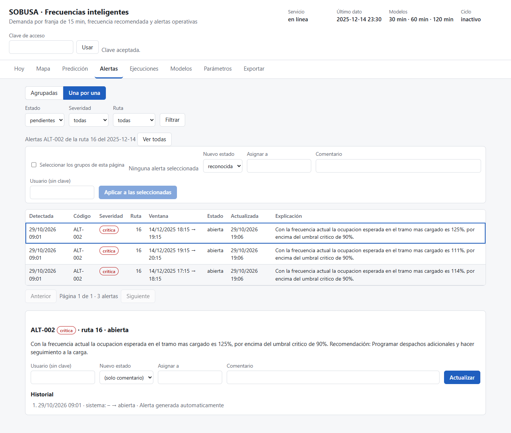
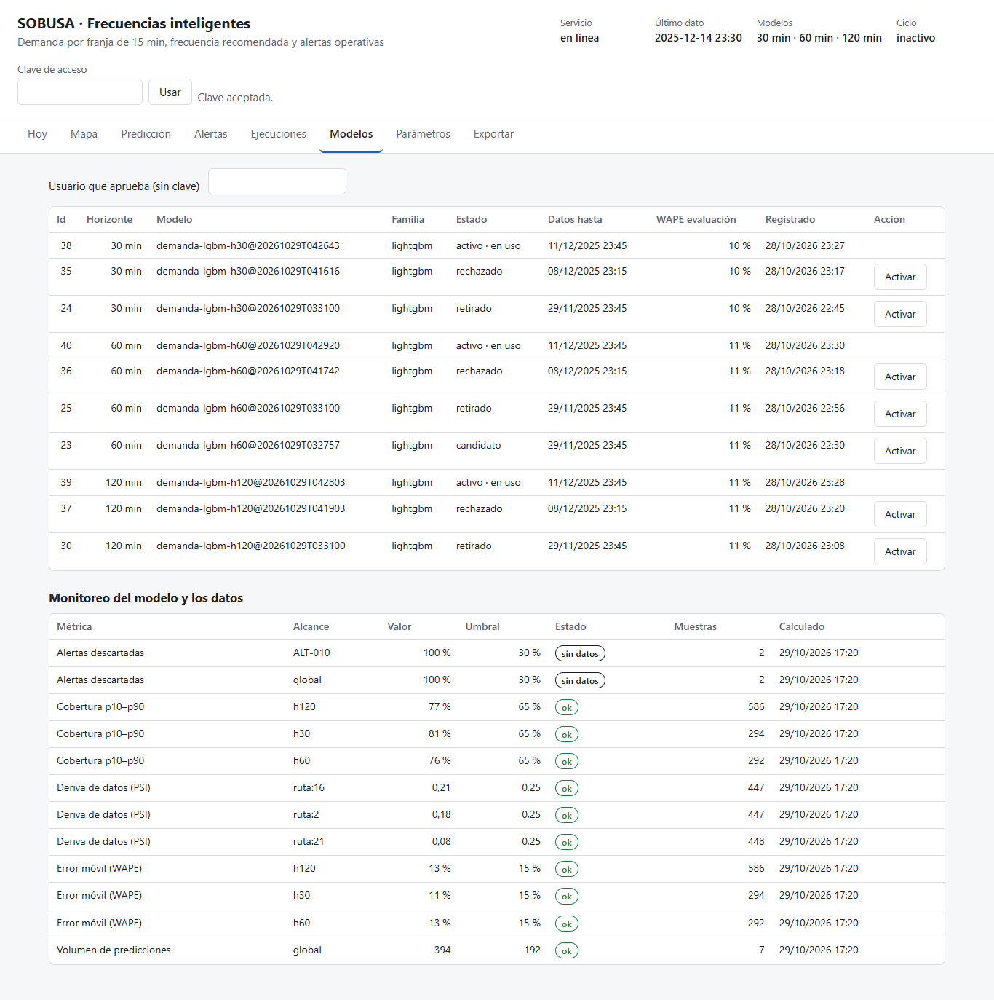
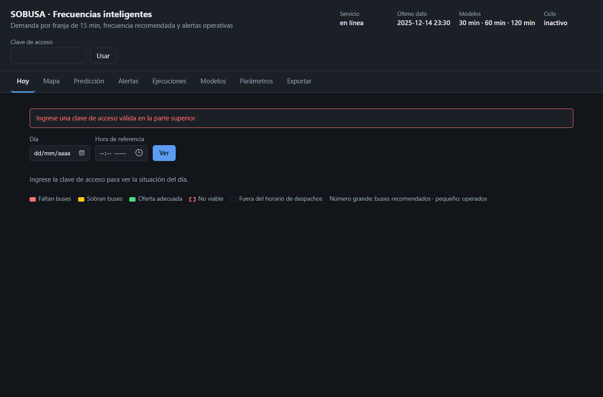

# Manual de usuario

Guía del tablero para el personal de operación y planeación de SOBUSA: consultar la demanda prevista, leer la recomendación de frecuencia, gestionar alertas y seguir el estado del sistema.

El tablero se abre en `http://<servidor>:8000/`, funciona en computador y en celular, y se puede usar solo con el teclado.

## 1. Entrar

1. Abra el tablero. Arriba ve el estado del servicio, la fecha del último dato recibido, los modelos en uso y si hay un ciclo en curso. Si el servicio dice *sin preparar*, faltan datos o modelos: un aviso explica qué hacer y debe resolverlo el administrador.
2. Escriba la **clave de acceso** que le entregó el administrador y pulse **Usar**. El texto *Clave aceptada* confirma que sirve. La clave se guarda solo en este navegador.

| Rol de la clave | Qué puede hacer |
|---|---|
| Lector | Ver predicciones, recomendaciones, alertas, ejecuciones, modelos y exportar |
| Operador | Lo anterior, más calcular predicciones, lanzar o reintentar ciclos y gestionar alertas |
| Administrador | Lo anterior, más activar modelos y cambiar parámetros |

## 2. Hoy: qué hacer en cada ruta

Es la pantalla inicial. Muestra las tres rutas a la vez, con lo que el sistema ya calculó en el último ciclo, así que carga al instante.

- **Día y hora de referencia.** Por defecto es el momento actual. Con los datos de demostración, que terminan en diciembre de 2025, es el último día con datos a las 6:00. Puede elegir otro día u otra hora y pulsar **Ver**.
- **Ahora y Después.** Indican qué hacer en la hora en curso y en la siguiente, en lenguaje operativo:
  - *Agregar 2 buses entre 06:15 y 07:15: de 10 a 12 por hora*;
  - *Se pueden retirar 3 buses…*;
  - *Mantener…*.

  El color del borde dice si faltan buses (rojo), sobran (ámbar) o la oferta es adecuada (verde).
- **Franja del día.** Una casilla por hora:
  - número grande: buses recomendados;
  - número pequeño y flecha: buses operados (▲ faltan, ▼ sobran, = igual);
  - la casilla con contorno azul es la hora de referencia.

  Al pasar el mouse sobre una casilla, o con un lector de pantalla, se lee la recomendación completa.
- **Despachos.** Muestra el horario de despachos de la ruta ese día, de la primera a la última salida programada (o la habitual de las 4 semanas previas). Las horas fuera de ese horario aparecen en gris como *fuera de servicio*: no se recomiendan salidas cuando la ruta ya cerró. En la última hora de servicio, que suele quedar a medias, los buses operados se cuentan como tasa por hora dentro del servicio para compararlos bien con la recomendación.
- **Horas del día y alertas pendientes.** Cuántas horas tienen déficit o exceso, cuántas alertas siguen pendientes en la ruta (y cuántas son críticas) y las tres más importantes del día.
- **Ver predicción de esta hora.** Abre la pestaña *Predicción* con la ruta y la hora ya puestas y calcula el detalle.
- **Ver alertas de la ruta.** Abre *Alertas* agrupadas, filtradas por esa ruta.
- **Ver en el mapa.** Abre el *Mapa* con la ruta, el tipo de día y la hora de referencia.

## 3. Mapa

Muestra el recorrido de las rutas sobre el mapa de Barranquilla (OpenStreetMap), dividido en tramos de 500 m.

- **Filtros.** Elija la ruta, el tipo de día (hábil, sábado, domingo o festivo) y la hora, y pulse **Ver**.
- **Con todas las rutas**, cada ruta tiene su color.
- **Con una sola ruta**, cada tramo se colorea según qué tan lleno va el bus en ese punto: el percentil 90 de la carga a bordo frente a la capacidad.
  - verde: menos de 65 %;
  - ámbar: de 65 % a 90 %;
  - rojo: 90 % o más;
  - gris: sin viajes observados a esa hora.
- **Tramo más cargado.** Cada ruta lo tiene marcado con un círculo.
- **Detalle.** Al pasar el mouse sobre un tramo se ve la ruta, el segmento, el kilómetro, la carga, la ocupación y cuántos viajes la respaldan.

Debajo del mapa, la tabla **Segmentos más cargados** tiene los mismos datos en texto, útil con lector de pantalla. Al seleccionar una fila, el mapa se acerca a ese tramo.

El mapa base se descarga de internet (Leaflet desde unpkg.com y las teselas desde tile.openstreetmap.org). Sin conexión, el tablero lo avisa y la tabla sigue funcionando.

## 4. Predicción y recomendación

1. Elija la **ruta** y la **hora de referencia** (hora de Colombia). Si la deja vacía, se usa el último dato disponible.
2. Marque **Guardar en ai_frecuencias** si quiere que la predicción y sus alertas queden registradas; sin marcar, es solo una consulta.
3. Pulse **Calcular**.

Cómo leer el resultado:

- **Gráfico.**
  - Línea azul: pasajeros previstos en cada franja de 15 minutos de las próximas 2 horas.
  - Banda azul clara: intervalo del 80 %. En 8 de cada 10 franjas la demanda real cae dentro.
  - Línea naranja: lo observado, si ya existe.
  - Línea punteada: el promedio de las últimas 4 semanas, que es la referencia sin modelo.
- **Recomendación por hora.** Una tarjeta por hora con:
  - **Buses por hora** recomendados y, entre paréntesis, los que se operan hoy.
  - **Headway**: minutos entre despachos.
  - **Vehículos requeridos** frente a la flota disponible.
  - **Ocupación esperada** con la recomendación y con la oferta actual.
  - **Limitado por**: qué decidió la cifra.
    - *Función objetivo*: el mejor balance entre costo de operación, espera de los pasajeros, sobreocupación y cambio frente a lo actual.
    - *Servicio mínimo*: el headway máximo permitido.
    - *Capacidad crítica*: no se puede bajar sin pasar del 90 % de ocupación.
    - *Headway mínimo* o *flota disponible*: tope operativo.
  - **Pasajeros en riesgo de no abordar**: los que quedarían sobre la capacidad en el tramo más cargado, con la recomendación y con la oferta actual.
  - **Recaudo esperado**: pasajeros por tarifa. Muestra *falta definir la tarifa* hasta que el administrador publique el parámetro `tarifa_pasajero`.
  - **Costo ponderado** y sus **componentes**, para entender la decisión, y la **línea base** de las fórmulas de referencia para comparar.
  - **Tramo más cargado**: el segmento de la ruta con mayor carga a esa hora.
  - La etiqueta **no viable** indica que la demanda no se puede atender con las restricciones configuradas; la tarjeta explica por qué.
- **Detalle por franja.** Predicción, intervalo, observado, promedio de 4 semanas y las variables que más pesaron en cada predicción (por ejemplo, *hora del día +38 %*).

## 5. Alertas

Por defecto las alertas se ven **agrupadas**: una fila por ruta, código y día, con el número de alertas, las horas en que ocurrieron y un ejemplo de la explicación. En la demostración, 775 alertas pendientes caben en 178 grupos. El filtro *Estado* empieza en *pendientes* (abiertas, reconocidas o asignadas). También se puede filtrar por severidad (crítica, preventiva o informativa) y por ruta.

**Gestionar en lote**, con rol operador o administrador:

1. Marque los grupos, o use *Seleccionar los grupos de esta página*. Arriba se indica cuántas alertas quedaron seleccionadas.
2. Elija el nuevo estado y, si aplica, a quién se asigna. Escriba un comentario y su nombre.
3. Pulse **Aplicar a las seleccionadas**.

Cada alerta guarda el cambio en su bitácora. Si alguna no se podía cambiar (por ejemplo, porque ya estaba cerrada), el mensaje lo indica.

Al seleccionar un grupo se pasa a la vista **Una por una** con las alertas de ese grupo. El botón *Ver todas* quita el filtro.

En la vista una por una, cada alerta muestra el valor observado, el esperado, el umbral y una explicación en lenguaje operativo. Al seleccionarla se abre el detalle con su bitácora.

Para gestionarla, con rol operador o administrador:

1. Escriba su nombre en **Usuario**.
2. Elija el nuevo estado (**reconocida**, **asignada**, **cerrada** o **descartada**) y, si aplica, a quién se asigna.
3. Agregue un comentario y guarde. El cambio queda en la bitácora.

Descarte una alerta, sola o en lote, solo cuando no corresponda a un problema real. El sistema mide el porcentaje de alertas descartadas por tipo: si pasa del 30 %, la regla se marca para revisar sus umbrales.

| Código | Qué significa | Qué hacer |
|---|---|---|
| ALT-001 | La demanda prevista supera la capacidad con la oferta actual | Subir buses por hora o reducir el headway |
| ALT-002 | Ocupación esperada u observada sobre el umbral crítico | Despacho adicional y seguimiento |
| ALT-003 | La frecuencia actual no cubre la demanda | Aplicar el intervalo recomendado |
| ALT-004 | Ocupación prevista muy baja | Evaluar ampliar el intervalo |
| ALT-005 | La demanda real cayó por debajo de lo esperado | Validar evento, ruta o captura |
| ALT-006 | En una hora, varios despachos programados salieron cancelados, sin iniciar o fuera de plazo | Verificar vehículos, conductores y operación en terminal |
| ALT-007 | La demanda real superó lo esperado | Revisar la frecuencia |
| ALT-008 | Valores atípicos en los datos consolidados | Validar la fuente y el periodo |
| ALT-009 | Faltan datos o llegan atrasados | Reprocesar o restablecer la fuente |
| ALT-010 | El modelo se degradó: error alto o intervalo mal calibrado | El sistema reentrena; el administrador puede revertir el modelo |

## 6. Ejecuciones

Muestra cada lectura de datos y cada ciclo con su estado, etapa, avance, intento, ventana de datos y error.

- **Ejecutar ciclo.** Elija origen, días y modo de reentrenamiento y pulse **Ejecutar ciclo**. Mientras corre, la tabla se actualiza sola cada 5 segundos y muestra la etapa y el porcentaje. Si ya hay un ciclo en curso, el sistema lo avisa y no inicia otro.
- **Reintentar.** Un ciclo *fallida* o *interrumpida* (por ejemplo, porque se reinició el servidor) muestra el botón **Reintentar**. El reintento retoma los datos pendientes y queda enlazado con el original.
- Al seleccionar una fila se ve el detalle completo: datos leídos, alertas generadas, monitoreo y decisión de reentrenamiento.

## 7. Modelos y monitoreo

- **Modelos.** Versiones registradas por horizonte, con su estado (*activo · en uso*, *candidato*, *retirado*, *rechazado*), la fecha de corte de sus datos y su error de evaluación. Un administrador puede **Activar** otra versión; sirve para revertir.
- **Monitoreo del modelo y los datos**, recalculado en cada ciclo:
  - **Deriva de datos (PSI)** por ruta: cuánto cambió la demanda reciente frente a la que vio el modelo. Sobre 0,25 se reentrena.
  - **Error móvil (WAPE)** por horizonte: error de los últimos 7 días.
  - **Cobertura p10–p90**: debe rondar el 80 %. Bajo 65 %, el intervalo está mal calibrado.
  - **Volumen de predicciones**: avisa si se generan muchas menos que de costumbre.
  - **Alertas descartadas**: porcentaje por tipo de alerta.

  El estado *ok* está bien, *alerta* exige atención y *sin datos* indica que aún no hay muestra suficiente.

## 8. Parámetros

Lista los umbrales y pesos vigentes, con unidad, descripción y versión: ocupación objetivo y crítica, capacidad, headways, tolerancias de alertas, pesos de la función objetivo y umbrales de monitoreo. Un administrador puede publicar un valor nuevo, general o para una ruta. La versión anterior se conserva y el cambio rige desde el siguiente cálculo, sin reiniciar nada.

## 9. Exportar

Elija el recurso (predicciones, recomendaciones, alertas, ejecuciones o calidad de datos), los filtros y el formato **CSV** o **Excel**, y pulse **Exportar**.

## 10. Accesibilidad

- **Teclado.** Las flechas izquierda y derecha cambian de pestaña; *Inicio* y *Fin* van a la primera y a la última; *Enter* abre la fila seleccionada.
- **Contraste.** Es de 5,7:1 o más en modo claro y oscuro (WCAG AA).
- **Tema.** El tablero sigue el modo claro u oscuro del sistema.

